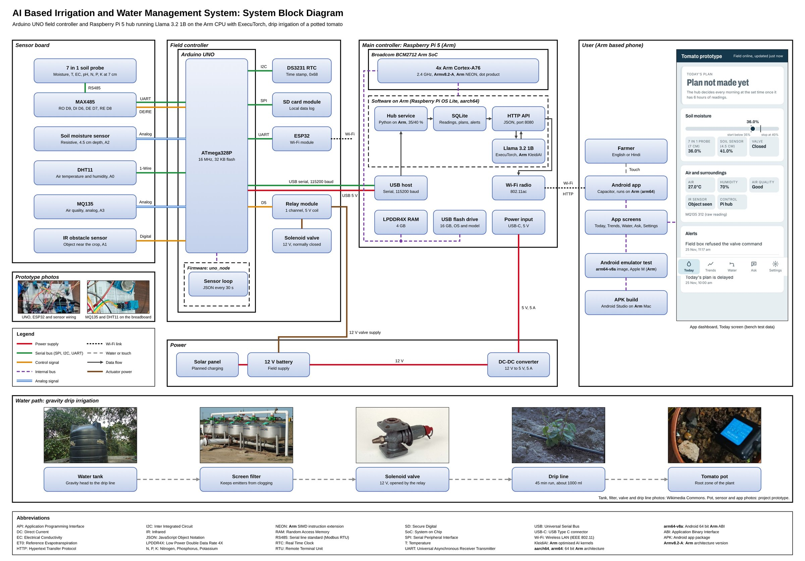
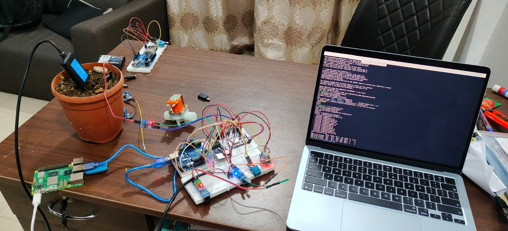
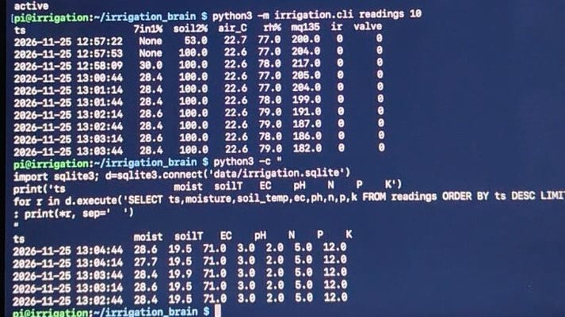
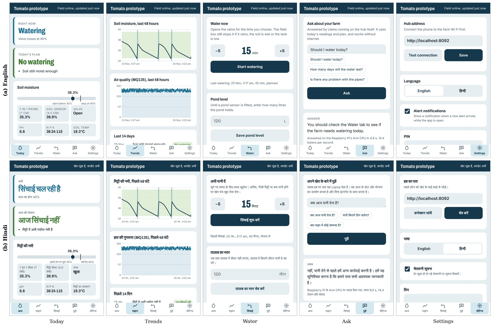
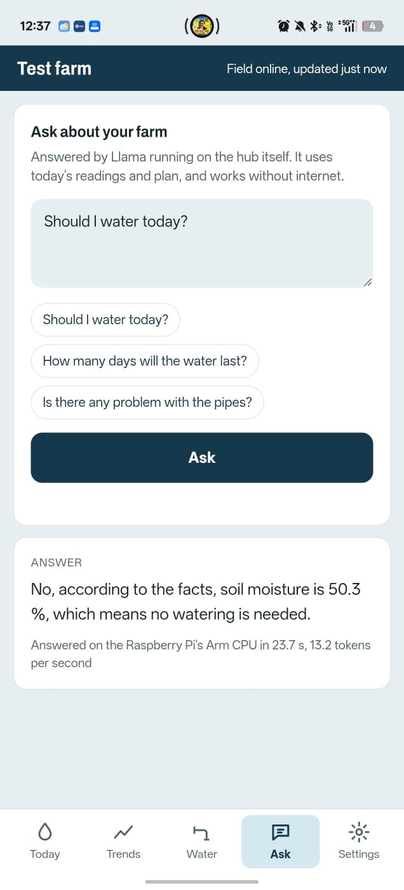
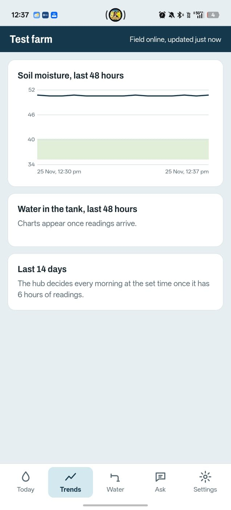
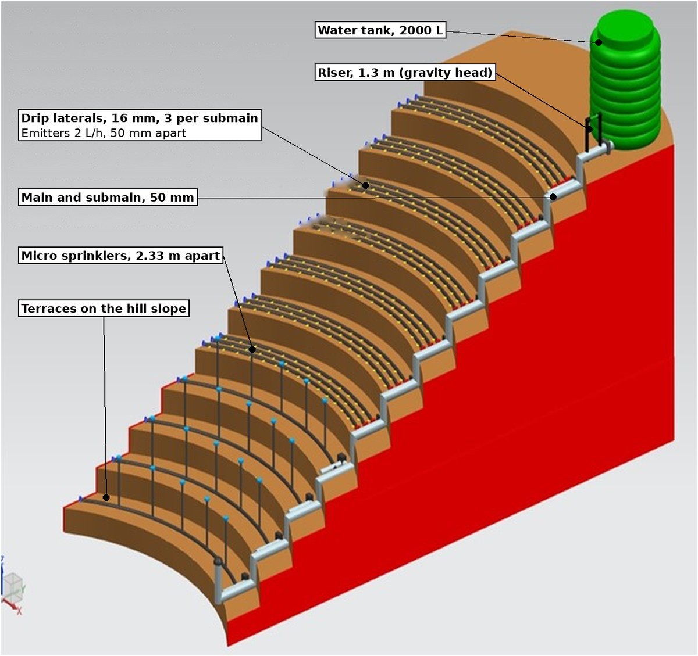
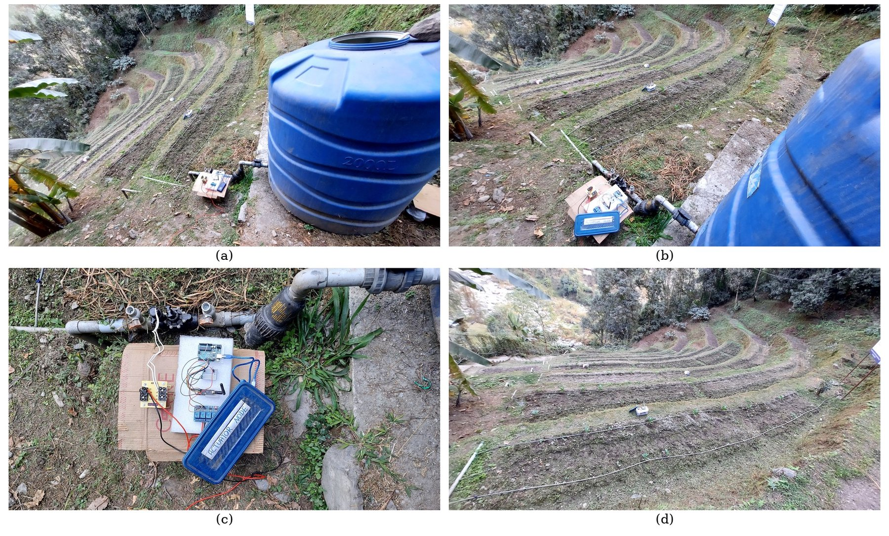
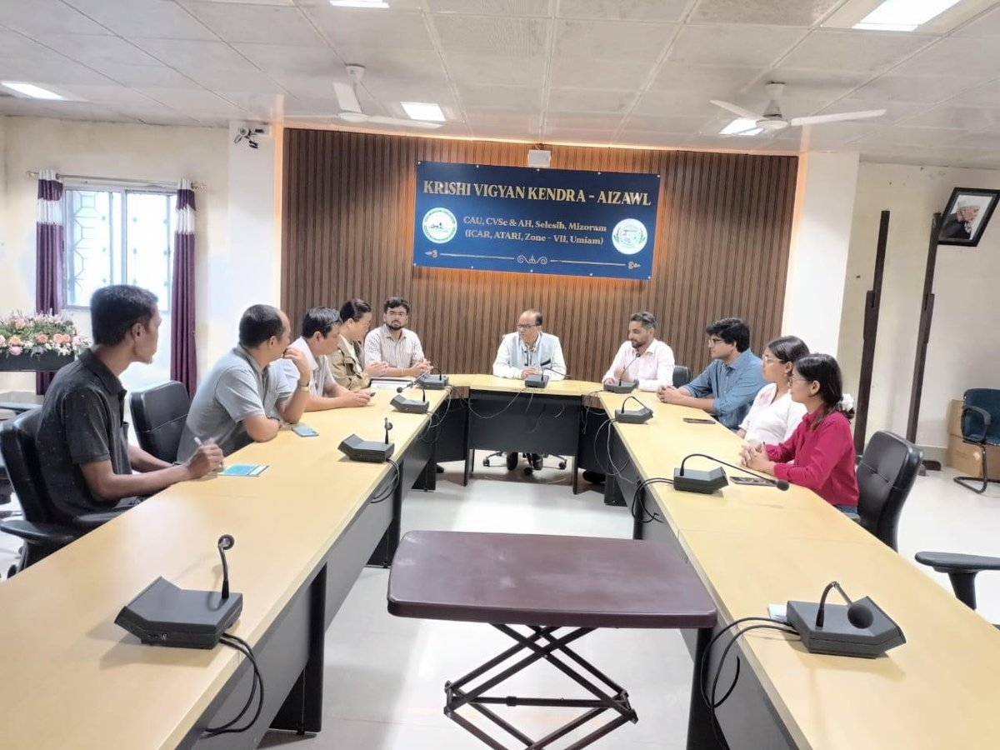
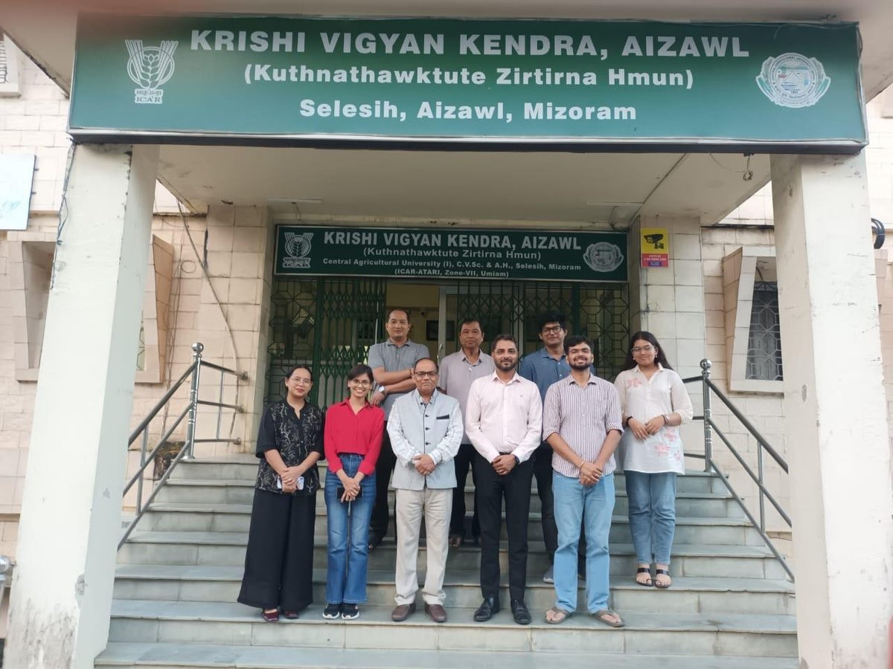

<div align="center">

# AI Based Irrigation and Water Management System

**Offline drip irrigation decision support with Llama 3.2 1B on the Arm CPU of a Raspberry Pi 5**


**Bharat AI SoC Student Challenge** · Theme: Agriculture and Food Security<br>
**Problem Statement 1:** Offline crop disease/pest detection and advisory for farmers

National Institute of Technology Mizoram

**[Demo video](https://drive.google.com/file/d/1VXh8rzRxHOA21tu4lEKKEYOoKbRoDuBf/view?usp=sharing)** · **[Project report](docs/Final_Project_Report.pdf)**

</div>

---

## Overview

Small farms in hilly regions store water in tanks and water their crops by habit. Too much water is wasted on wet days and the crop suffers on dry ones. Most smart irrigation products need the internet, show numbers without reasons, and rarely speak the farmer's language.

This project puts the whole decision system **on the farm**. Sensors measure the soil and the air near the crop, a Raspberry Pi 5 decides when to start and stop watering, and an Android app shows everything in **English or Hindi**. The farmer can simply ask *"Should I water today?"* and **Llama 3.2 1B, running on the Pi's own Arm CPU through ExecuTorch**, answers from the live readings. **No internet is needed at any point.**

<p align="center">
  
  <br><em>System block diagram. Arm processors are marked in bold.</em>
</p>

## Highlights

| | |
|---|---|
| **On device AI** | Llama 3.2 1B Instruct on 4x Arm Cortex A76, ExecuTorch with XNNPACK and Arm KleidiAI |
| **Answer speed** | **14.1 to 14.5 tokens/s** writing, **about 130 tokens/s** reading the question |
| **Response time** | First word in **1.4 s**, full answer in **4.7 to 12.1 s** |
| **Memory** | **921 MB** of 4 GB while answering |
| **Thermals** | 44 °C idle, 72 °C peak, **no throttling**, no cooler fitted |
| **Automatic watering** | Starts below **35 %** soil moisture, stops at **40 %**, with safety rules on the field controller |
| **Sensors** | 7 in 1 soil probe (moisture, temperature, EC, pH, N, P, K), resistive soil sensor, DHT11, MQ135, IR, RTC |
| **Languages** | English and Hindi in the app and in the AI answers |
| **Connectivity** | Fully offline: sensing, decisions, database, app server and Llama all run on the farm |

## How it works

1. **Sense.** An Arduino UNO reads every sensor every 30 seconds and sends one JSON line over USB to the Raspberry Pi 5, and the same line to an ESP32 WiFi module.
2. **Store.** The Pi checks each line and stores it in an SQLite database.
3. **Decide.** Below 35 % soil moisture the Pi starts a 45 minute watering run and stops it at 40 %. The UNO checks the soil itself before opening the valve, limits every run to 90 minutes and follows the same rule on its own if the Pi is silent for 30 minutes.
4. **Plan.** Every morning the Pi works out the day's crop water need from air temperature with the Hargreaves equation and FAO 56 crop coefficients.
5. **Explain.** The app reads everything from the Pi over WiFi. Questions in the **Ask** tab go to Llama on the Pi together with the latest readings, so every answer matches the real crop.

## Prototype

<p align="center">
  
  <br><em>Laboratory prototype: 7 in 1 soil probe and resistive sensor in the pot, 12 V solenoid valve, sensor board with Arduino UNO, MAX485, DHT11, MQ135, IR and relay, and the Raspberry Pi 5.</em>
</p>

<p align="center">
  
  <br><em>Live readings stored by the hub on the Raspberry Pi 5, one every 30 seconds.</em>
</p>

**Prototype run on 25 November 2026** (68 readings, 12:30 to 13:07):

| Sensor | Min | Mean | Max |
|---|---:|---:|---:|
| Soil moisture, 7 in 1 probe (%) | 27.7 | 28.5 | 30.0 |
| Soil temperature (°C) | 18.3 | 19.5 | 19.9 |
| EC (µS/cm) | 71 | 71 | 71 |
| Air temperature (°C) | 22.6 | 22.7 | 23.8 |
| Air humidity (%) | 65 | 76.7 | 79 |
| MQ135 (raw) | 171 | 238 | 321 |

At 12:58:09 the probe read **30.0 %**, below the 35 % start level, and **the hub sent a 45 minute watering command on its own**. During the run the Pi stayed at **45.5 °C with no throttling** and used **433 MB** of memory.

## Farmer app in English and Hindi

<p align="center">
  
  <br><em>Today, Trends, Water, Ask and Settings in English (top) and Hindi (bottom).</em>
</p>

<table>
<tr>
<td width="50%" align="center"><br><em>Llama answer from the Pi during the prototype run</em></td>
<td width="50%" align="center"><br><em>Soil moisture trend from the prototype readings</em></td>
</tr>
</table>

## Llama on the Arm CPU

| Step | Detail |
|---|---|
| Model | Llama 3.2 1B Instruct (Meta) |
| Quantisation | 8da4w: 4 bit weights in groups of 128, 8 bit dynamic activations, 4 bit embeddings |
| Export | ExecuTorch 1.5 `export_llm` with the XNNPACK partitioner, KV cache and custom SDPA, on an Apple M series Mac (Arm) |
| Runtime | ExecuTorch `llama_main` built for the Armv8.2 architecture with dot product and FP16 extensions, tuned for the Cortex A76, with Arm KleidiAI kernels in XNNPACK |
| Grounding | The hub passes its live facts and one key sentence; the model explains, the hub controls the valve |

**Thread scaling on the Raspberry Pi 5**

| Threads | Reading the question (tokens/s) | Writing the answer (tokens/s) | Total time (s) |
|---:|---:|---:|---:|
| 1 | 42.1 | 15.3 | 8.05 |
| 2 | 78.3 | 16.5 | 5.99 |
| 4 | **129.9** | 14.5 | **5.31** |

Reading the question gets **3.1 times faster** on four cores. Writing the answer is set by memory speed, so it stays near 15 tokens/s.

### Where Arm is used

| Device | Processor | Role |
|---|---|---|
| **Raspberry Pi 5** | Broadcom BCM2712, **4x Arm Cortex A76** | Hub, database, app server, Llama through ExecuTorch |
| **Android phone** | **Arm** based SoC (arm64) | Farmer app |
| **Development Mac** | Apple M series (**Arm**) | Model export, app build, emulator test |
| Field controller | Arduino UNO today, **Arduino UNO R4 with Arm Cortex M4** next | Sensors and valve |

## Hardware

| Part | Role | Connection to the UNO |
|---|---|---|
| Raspberry Pi 5, 4 GB | Main controller | USB |
| Arduino UNO | Field controller | |
| ESP32 | WiFi module | D10 to ESP32 RX (1 k / 2 k divider), ESP32 TX to D11 |
| 7 in 1 soil probe | Moisture, temperature, EC, pH, N, P, K at 7 cm | MAX485: RO D9, RE D8, DE D7, DI D6 |
| Resistive soil sensor | Moisture at 4.5 cm | A2 |
| DHT11 | Air temperature and humidity | A0 |
| IR sensor | Object near the crop | A1 |
| MQ135 | Air quality | A3 |
| DS3231 RTC | Time stamps | A4 (SDA), A5 (SCL) |
| SD card module | Local log | SPI |
| Relay and 12 V solenoid valve | Drip line on and off | `PIN_RELAY` |
| 12 V battery, DC to DC converter | Power, solar charging in the field design | |

The complete list with specifications is in Appendix A of the [project report](docs/Final_Project_Report.pdf).

## Field design and execution plan

<table>
<tr>
<td width="45%" align="center"><br><em>Gravity fed drip layout for a terraced hill field</em></td>
<td width="55%" align="center"><br><em>Reference drip installation on a terraced plot with a 2000 L tank, filter, solenoid valve and actuator node</em></td>
</tr>
</table>

| Phase | Work | Result |
|---|---|---|
| 1. Install | Pi hub and UNO in the actuator box, existing solenoid valve on the relay, probe and sensors in the field node | Automatic watering on the real plot |
| 2. Power and water level | Solar panel, battery, level sensor on the 2000 L tank | Unattended running, days of water left in the app |
| 3. Calibrate | Soil probe against reference meters and KVK soil tests, crop specific levels | Trusted readings and rules for each crop |
| 4. Scale and evaluate | One probe and valve per terrace, one season with farmers, camera for disease and pest advice | Measured water saving and farmer feedback |

## Repository layout

| Path | Contents |
|---|---|
| [`prototype/`](prototype) | **The working system** |
| [`prototype/firmware/uno_node/`](prototype/firmware/uno_node) | Arduino UNO sketch: all sensors, relay, safety rules, SD log, ESP32 link |
| [`prototype/irrigation/`](prototype/irrigation) | Pi software: serial reader, watering rules, daily plan, database, API, Llama assistant |
| [`prototype/app/`](prototype/app) | Android app (Capacitor), English and Hindi |
| [`prototype/tools/llama/`](prototype/tools/llama) | Model export script, export settings, benchmark |
| [`prototype/deploy/`](prototype/deploy) | systemd services that start the hub and the API on boot |
| [`prototype/docs/`](prototype/docs) | Block diagram (PDF, PNG, SVG) and its source |
| [`docs/`](docs) | Project report and images |
| Other top level folders | Earlier two board radio design, kept for reference ([notes](docs/EARLIER_DESIGN.md)) |

## Quick start

**1. Arduino UNO** (Arduino IDE or `arduino-cli`, library: *DHT sensor library* by Adafruit)

```bash
arduino-cli core install arduino:avr
arduino-cli lib install "DHT sensor library" "Adafruit Unified Sensor" SD
arduino-cli compile --fqbn arduino:avr:uno prototype/firmware/uno_node
arduino-cli upload -p /dev/cu.usbmodem101 --fqbn arduino:avr:uno prototype/firmware/uno_node
```

Then plug the UNO into the Raspberry Pi by USB.

**2. Raspberry Pi 5** (Raspberry Pi OS Lite 64 bit)

```bash
sudo apt install -y git python3-serial
git clone <repository link> ~/irrigation_brain
cd ~/irrigation_brain/prototype
cp settings.example.json settings.json      # set planting_date, app_pin, farm_name
sudo cp deploy/*.service /etc/systemd/system/
sudo systemctl daemon-reload
sudo systemctl enable --now irrigation-hub irrigation-api
python3 -m irrigation.cli readings 10        # live readings from the UNO
```

**3. Llama.** On a Mac with access to `meta-llama/Llama-3.2-1B-Instruct`, run `bash tools/llama/export_on_mac.sh`, then copy `model.pte`, `tokenizer.model` and the ExecuTorch runner to `~/llama` on the Pi. Full steps in [`prototype/tools/llama/README.md`](prototype/tools/llama/README.md).

**4. App.**

```bash
cd prototype/app
npm install && npm run android:add && npm run sync
cd android && ./gradlew assembleDebug
```

Install the APK on the phone and enter `http://<Pi address>:8080` in Settings.

## Documents

| | |
|---|---|
| Project report | [docs/Final_Project_Report.pdf](docs/Final_Project_Report.pdf) |
| Demo video | [Watch on Google Drive](https://drive.google.com/file/d/1VXh8rzRxHOA21tu4lEKKEYOoKbRoDuBf/view?usp=sharing) |
| Block diagram | [PDF](prototype/docs/System_Block_Diagram.pdf) · [SVG](prototype/docs/System_Block_Diagram.svg) |

## Team

| | |
|---|---|
| **Naman Shukla** (Team Leader) | B.Tech, Computer Science and Engineering, NIT Mizoram |
| **Stuti Singh** | B.Tech, Electronics and Communication Engineering, NIT Mizoram |
| **Amrita Vani** | M.Tech, Electronics and Communication Engineering, NIT Mizoram |
| **Dr. Pragati Singh** (Faculty Mentor) | Assistant Professor, Department of ECE, NIT Mizoram |

## Acknowledgements

We thank the senior scientists of **Krishi Vigyan Kendra, Aizawl** (Central Agricultural University, ICAR ATARI Zone VII) for discussing the water problems of hill farmers with us, which shaped the terraced field design and the local language assistant.

<p align="center">
  
  
</p>

## License

Code in this repository is released for the Bharat AI SoC Student Challenge. Llama 3.2 is used under the Llama 3.2 Community License; the model weights are not included in this repository.
