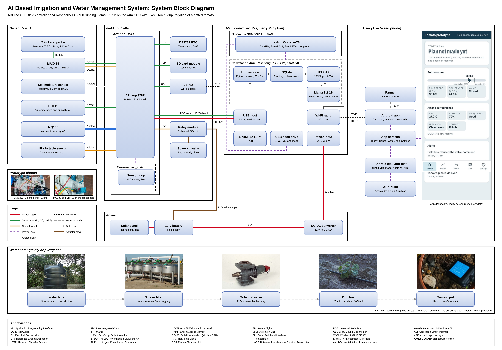

# AI Based Irrigation and Water Management System (prototype)

This folder holds the working prototype we built for the Bharat AI SoC Student Challenge,
Problem Statement 1 (Llama on the Arm CPU with ExecuTorch).

A tomato plant in a pot is watered by drip. An Arduino UNO reads the soil and the air around the plant
every 30 seconds and sends the readings to a Raspberry Pi 5 over USB. The Pi stores everything, decides
when the plant needs water, and shows it all in an Android app in English or Hindi. The farmer can also
ask questions in the app ("Should I water today?", "क्या आज पानी देना है?"). A Llama 3.2 1B model running
on the Pi's own Arm CPU answers from the live readings. Nothing needs the internet once it is set up.

## How it works

1. The UNO reads the 7 in 1 soil probe (moisture, temperature, EC, pH, N, P, K) at 7 cm depth, a resistive
   soil sensor at 4.5 cm, the DHT11 (air temperature and humidity), the MQ135 (air quality) and the IR
   sensor (something near the plant). It stamps the time from the RTC.
2. It sends one line of JSON to the Pi over USB and the same line to the ESP32 Wi Fi module.
3. The Pi saves each reading in an SQLite database and checks the watering rule: when the 7 in 1 probe
   reads below 35 % it starts a 45 minute run (about 1000 ml on our drip line) and stops it at 40 %.
   If the probe stops answering, the resistive sensor is used instead.
4. The Pi sends the valve command back to the UNO, which switches the relay for the solenoid valve.
   The UNO checks the soil itself before opening and closes at 40 % even without the Pi.
   If the Pi goes quiet for 30 minutes, the UNO follows the 35 / 40 % rule on its own.
5. Every morning the Pi also works out the day's crop water need from air temperature (Hargreaves method,
   FAO 56 tomato coefficients) and shows it as today's plan.
6. The app reads everything from the Pi over Wi Fi. Questions in the Ask tab go to Llama on the Pi, which is
   given the latest readings so its answer matches the real plant.

In this demo the relay is not wired, so the valve does not move. The commands, the UNO's replies and the
valve state still show in the app and the logs, so the whole decision path can be followed.

## System block diagram



PDF and SVG versions are in `docs/`. The figure is drawn from `docs/diagram_source/make.py`.

## Hardware

| Part | What it does | Connected to |
|---|---|---|
| Raspberry Pi 5, 4 GB | Main controller: database, decisions, app server, Llama | USB to the UNO, Wi Fi to the phone |
| Arduino UNO | Reads all sensors, switches the relay | USB to the Pi |
| ESP32 | Wi Fi module, gets every reading from the UNO | UNO D10 to ESP32 RX (with a 1 k / 2 k divider), ESP32 TX to UNO D11 |
| 7 in 1 soil probe | Moisture, temperature, EC, pH, N, P, K at 7 cm | MAX485: RO D9, RE D8, DE D7, DI D6 |
| Resistive soil sensor | Moisture at 4.5 cm | A2 |
| DHT11 | Air temperature and humidity | A0 |
| IR sensor | Detects something near the plant | A1 |
| MQ135 | Air quality | A3 |
| DS3231 RTC | Time for each reading | A4 (SDA), A5 (SCL) |
| SD card module | Local log on the UNO | SPI D11 to D13, CS on `PIN_SD_CS` |
| Relay and 12 V solenoid valve | Drip line on and off | `PIN_RELAY` on the UNO |
| 12 V battery and DC to DC converter | Power | Solar panel charging is planned for the field |

The SD card and the ESP32 both want pin D11. While the ESP32 is on D10 / D11 the sketch turns SD logging off
and says so in its first line. Moving the ESP32 to D2 / D3 lets both work.

## Results on the Raspberry Pi 5

Measured with `tools/llama/bench.py`: five questions in English and Hindi, each with the farm readings in the prompt.

| | Result |
|---|---|
| Model | Llama 3.2 1B Instruct, 4 bit weights and 8 bit activations, 765 MB |
| Runtime | ExecuTorch 1.5, XNNPACK backend with Arm KleidiAI kernels, built for the Cortex-A76 |
| Writing the answer | 14.1 to 14.5 tokens per second |
| Reading the question | about 130 tokens per second |
| First word appears after | 1.4 to 1.5 s |
| Full answer | 4.7 to 12.1 s |
| Memory | 921 MB of 4 GB |
| Temperature | 44 C idle, 72 C at the end, no throttling |

| Threads | Reading (tokens/s) | Writing (tokens/s) |
|---|---|---|
| 1 | 42.1 | 15.3 |
| 2 | 78.3 | 16.5 |
| 4 | 129.9 | 14.5 |

Reading the question gets 3.1 times faster with four cores. Writing the answer is limited by memory speed,
so extra cores do not help it. The UNO sketch uses 66 % of flash and 74 % of RAM.

## Where Arm is used

The Raspberry Pi 5 (four Arm Cortex-A76 cores) runs the hub, the database, the app server and Llama.
The Android phone running the app is Arm based, and we exported the model on an Apple M series Mac, also Arm.
The UNO (AVR) and the ESP32 (Xtensa) are not Arm; an Arduino UNO R4 (Cortex-M4) would fit the same pins.

## What is in this folder

| Folder | Contents |
|---|---|
| `firmware/uno_node/` | Arduino UNO sketch |
| `irrigation/` | Pi software: serial reader, watering rules, daily plan, database, app server, Llama assistant |
| `app/` | Android app (Capacitor), English and Hindi |
| `tools/llama/` | Model export script for the Mac, export settings, benchmark |
| `tools/find_soil_registers.py` | Finds the soil probe's Modbus registers |
| `deploy/` | Services that start the hub and the app server on boot |

The files outside this folder are our earlier design with two Arduinos and an NRF24L01 radio.

## Setting it up

**Arduino UNO.** Install the "DHT sensor library" by Adafruit in Arduino IDE. Open
`firmware/uno_node/uno_node.ino`, check `PIN_RELAY` and `PIN_SD_CS` at the top, upload, then plug the UNO into the Pi.
`SOIL2_DRY` and `SOIL2_WET` calibrate the resistive sensor (reading in dry air and in water).

**Raspberry Pi 5** (Raspberry Pi OS Lite 64 bit):

```bash
sudo apt install -y git python3-serial
git clone <repository link> ~/irrigation_brain
cd ~/irrigation_brain/prototype
cp settings.example.json settings.json        # set planting_date, app_pin and farm_name
sudo cp deploy/*.service /etc/systemd/system/
sudo systemctl daemon-reload && sudo systemctl enable --now irrigation-hub irrigation-api
curl localhost:8080/api/health
python3 -m irrigation.cli readings 10          # latest readings from the UNO
```

The hub finds the UNO on `/dev/ttyACM*` or `/dev/ttyUSB*` by itself.

**Llama.** On a Mac with Python 3.12 and Hugging Face access to `meta-llama/Llama-3.2-1B-Instruct`, run
`bash tools/llama/export_on_mac.sh`, then copy `model.pte`, `tokenizer.model` and the ExecuTorch runner
(`llama_main`, `libllama_runner.so`) to `~/llama` on the Pi. Details in `tools/llama/README.md`.
The model weights are not in this repository (Llama 3.2 Community License).

**App.** On the Mac with Node and Android Studio:

```bash
cd prototype/app
npm install && npm run android:add && npm run sync
cd android && ./gradlew assembleDebug
```

Install `app/build/outputs/apk/debug/app-debug.apk` on the phone, then in Settings enter the Pi's address
with port 8080 and the PIN.

## Data

Readings, daily plans, valve commands and alerts are kept in `data/irrigation.sqlite` on the Pi.
The database starts empty; only real readings from the UNO go into it.

## Next steps

Wire the relay and valve on the drip line, charge the battery from the solar panel, use N, P and K for
fertigation, add a tank level sensor so watering time can follow the tank head, and try the Llama 3.2 3B model.
